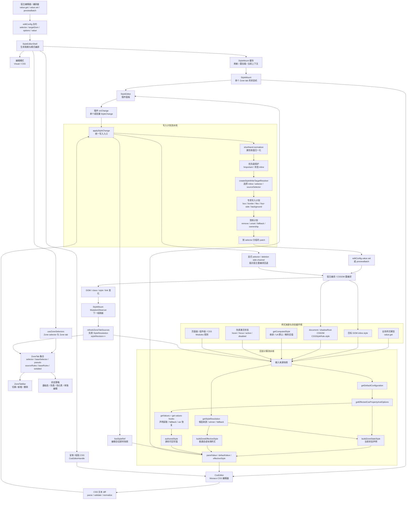
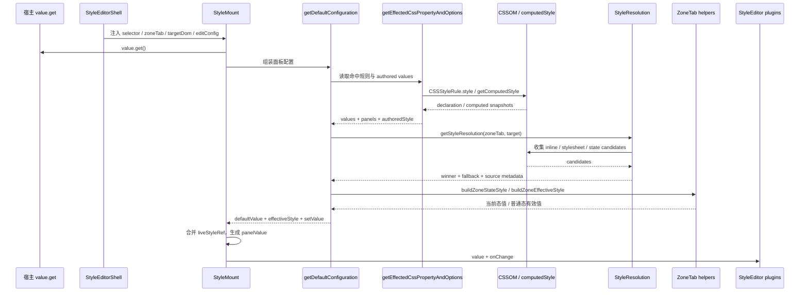
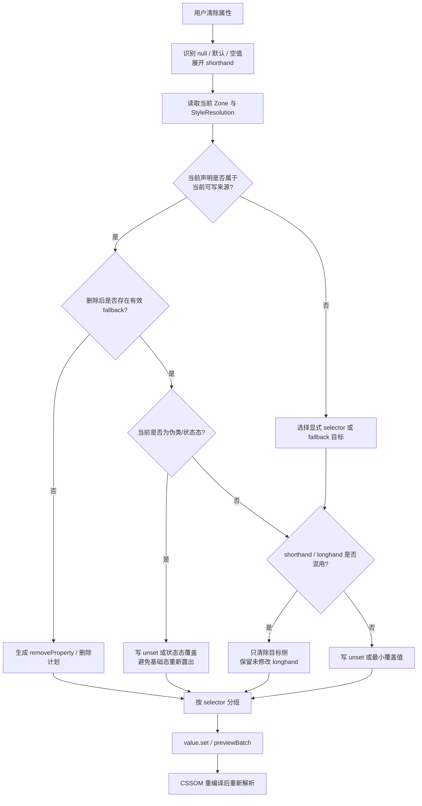
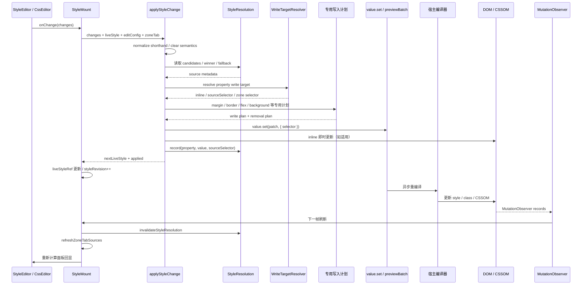
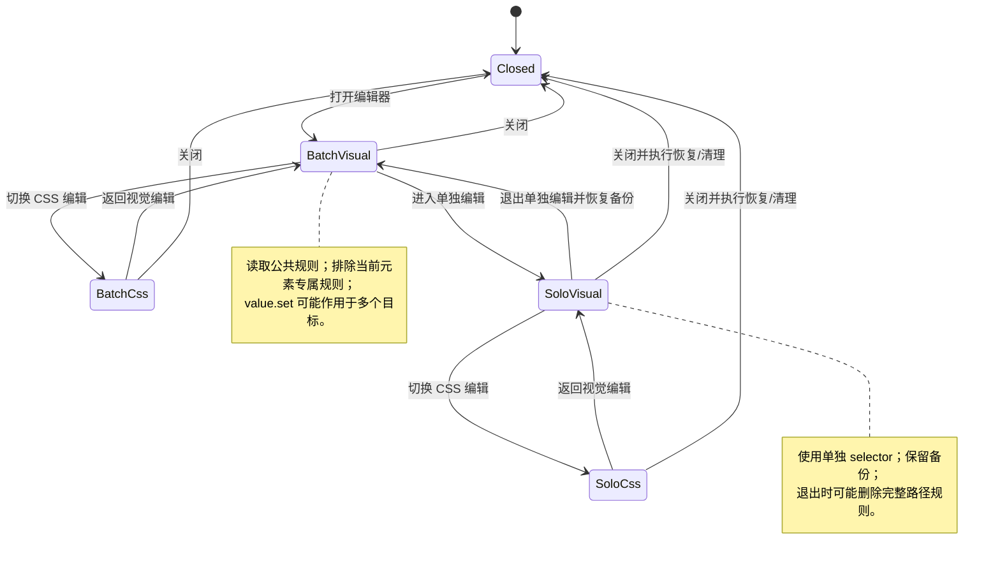
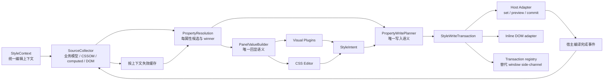

# StyleEditor 架构文档

> 适用范围：`/Users/leo/Project/lingzhu/editors-pc-common/src/style_new`
>
> 主入口：`/Users/leo/Project/lingzhu/editors-pc-common/src/style_new/StyleEditorShell.tsx`
>
> 本文以当前代码为准，先描述事实上的运行链路，再给出针对“样式计算回显”和“更新后样式写入”的目标架构建议。文中“当前实现”表示代码已经存在的行为；“建议”表示后续可演进方向，不代表已经落地。

## 1. 阅读结论

StyleEditor 不是简单的“读取一个 style 对象，再调用 `value.set()`”的表单组件。它实际上同时维护了五类状态：

1. **业务/源码状态**：由 `editConfig.value.get()` 返回，通常是宿主保存的样式模型。
2. **CSSOM 声明状态**：来自命中的 `CSSStyleRule.style`、inline style 和 CSS Modules 运行时规则。
3. **浏览器计算状态**：来自 `getComputedStyle()`，包含继承、UA 默认值、其他 selector 和伪类影响。
4. **来源解析状态**：由 `StyleResolution`、`ZoneTab`、cascade winner 等结构描述“哪个来源真正生效”。
5. **编辑会话状态**：由 `liveStyleRef`、批量编辑元数据、显式 selector/deletion side-channel 组成，用于抵抗 `value.set()` 异步重编译带来的滞后。

因此，最重要的架构事实是：

- **回显值不是单一来源**。源码值、CSSOM 值、计算值和当前编辑快照需要按属性、状态和 selector 进行合并。
- **写入目标不是传入 selector 的简单替换**。写入前必须判断当前属性的 winner、fallback、伪类状态、inline 优先级、单独编辑模式以及 shorthand/longhand 关系。
- **回显和写入必须共享来源模型**。如果回显使用一套规则而写入使用另一套规则，就会出现“面板显示 A，写入覆盖 B”或“清除后又被 fallback 恢复”的问题。
- **MutationObserver 是回写闭环的一部分**。宿主的 `value.set()` 不保证同步更新 CSSOM，StyleMount 需要在重编译后重新扫描来源并刷新面板。

## 2. 总体分层

### 2.1 宿主适配层

入口类型在 `src/style_new/type.ts` 中定义。宿主至少提供：

- `editConfig.value.get()`：读取当前样式模型；
- `editConfig.value.set(style, { selector })`：写入样式模型；
- 可选 `previewBatch`、`commitBatch`、`discardBatch`：批量编辑事务；
- `editConfig.options`：插件、selector、target DOM、排除项等配置；
- `upload`、`getDefaultOptions` 等外部能力。

这一层不应该直接承载 CSSOM 算法。它是编辑器和宿主编译器之间的边界。

### 2.2 Shell 编排层

`StyleEditorShell.tsx` 负责编辑器生命周期和模式切换：

- 打开/关闭编辑器；
- 视觉编辑与 CSS 编辑模式切换；
- 当前 Zone selector / Zone tab；
- 批量编辑、单独编辑、退出单独编辑；
- `StyleMount` 缓存、重挂载和刷新；
- 复制/粘贴 CSS；
- 组装传给下层的 `editConfig`。

Shell 不应该决定某个 CSS 属性最终写入哪个规则；它只负责选择上下文并传递给下层。

### 2.3 Zone 与状态层

`useZoneSelectors.ts`、`zone-tab.ts`、`ZoneTabBar.tsx` 共同管理：

- 基础 selector 与状态 selector；
- `:hover`、`:focus`、`:active`、`:disabled` 等伪类状态；
- `sourceRules` 与 `baseRules`；
- 新增 tab 的 `isAdded`；
- 单独编辑规则的排除；
- tab 标签、排序和删除。

ZoneTab 是“当前编辑上下文”的核心对象，而不仅是 UI tab 数据。

### 2.4 回显计算层

主要由以下模块组成：

- `get-default-configuration.ts`：面板配置总装配；
- `get-effected-css.ts`：命中规则、计算样式和候选面板；
- `get-values.ts` / `get-values-hooks.ts`：声明读取、fallback、变量和特殊属性恢复；
- `style-property.ts`：属性候选来源、winner 和缓存；
- `zone-tab.ts`：当前状态样式和普通态有效样式；
- `normal-style-preview.ts`：伪类编辑时的普通态预览。

### 2.5 写入计划层

主要由以下模块组成：

- `apply-style-change.ts`：更新入口和总调度；
- `style-write-target.ts`：选择真实写入 selector/source；
- `box-spacing.ts`、`four-side-write.ts`：margin/padding/四方向属性；
- `border-write.ts`：border 与 border-radius；
- `flex-write.ts`：flex shorthand/longhand；
- `shorthand-normalizer.ts`：shorthand 归一化；
- `background-layer-ownership.ts`、`text-background-write.ts`：背景层和文本背景特殊处理。

### 2.6 UI 插件层

`StyleEditor/StyleEditor.tsx` 根据 options 组装插件面板，并把统一的 `defaultValue` 与 `onChange` 传给各插件。插件只应该表达用户意图，例如：

```ts
{ key: 'marginTop', value: '12px' }
{ key: 'backgroundColor', value: null }
```

属性的来源选择、清除语义和 CSS 写入不应由插件自行决定。

## 3. 大型总体架构图

下面的图按“外部输入 → 上下文解析 → 回显 → 用户修改 → 写入 → CSSOM 刷新”展开。图中的 `StyleResolution` 是连接回显和写入的共享语义层。



## 4. 主入口：StyleEditorShell

### 4.1 Shell 的职责边界

`StyleEditorShell` 是整个编辑器的 orchestration layer，职责可以归纳为四组：

| 职责 | 典型行为 | 不应承担的职责 |
| --- | --- | --- |
| 生命周期 | 打开、关闭、默认展开、刷新 | 计算 CSS cascade |
| 上下文选择 | 当前元素、selector、Zone tab、批量/单独编辑 | 判断属性 winner |
| 子编辑器管理 | `StyleMount` 缓存、视觉/CSS 模式切换 | 直接操作具体 CSS declaration |
| 跨模式操作 | 复制、粘贴、CSS 文本替换 | 处理每个属性的清除策略 |

### 4.2 两种编辑模式

#### 视觉编辑模式

典型链路：

```text
StyleEditorShell
  -> StyleMount
    -> getDefaultConfiguration / getStyleResolution
      -> StyleEditor
        -> plugin.onChange
          -> StyleMount.handleChange
            -> applyStyleChange
```

#### CSS 编辑模式

典型链路：

```text
StyleEditorShell
  -> CssEditor
    -> baselineStyle / cssValue
      -> Monaco 编辑
        -> blur 或 replaceCssBody
          -> CSS syntax validate
          -> parseToStyleData
          -> diffStyleData
          -> expandShorthandSnapshotChanges
          -> applyStyleChange
```

CSS 编辑模式并没有绕过样式写入核心。它将整段 CSS 文本转换成变更列表，最后仍然进入 `applyStyleChange`，因此视觉编辑与 CSS 编辑应共享相同的写入语义。

### 4.3 StyleMount 缓存与刷新

Shell 会缓存/复用 `StyleMount`，避免切换面板时完全丢失编辑上下文。但以下情况会触发刷新或重挂载：

- target DOM 改变；
- Zone tab 改变；
- 编辑模式改变；
- 宿主 CSS 重编译完成；
- 批量编辑元数据改变；
- 单独编辑规则进入或退出。

这种缓存策略提高了交互稳定性，但也意味着 `StyleMount` 内部必须把“当前回显快照”和“当前编辑会话快照”分开维护，不能只依赖 React props 的同步更新。

## 5. 样式回显架构

### 5.1 回显输入的优先级问题

面板回显至少会遇到以下来源：

| 来源 | 能表达什么 | 不能直接作为最终答案的原因 |
| --- | --- | --- |
| `value.get()` | 宿主保存的业务样式、源码值 | 可能未包含 CSSOM 中已编译或外部规则 |
| `CSSStyleRule.style` | 某条规则中真实声明的值 | 只代表一条规则，不代表 cascade winner |
| inline style | 当前元素的内联声明 | 可能被 `!important` 或状态规则竞争 |
| `getComputedStyle()` | 浏览器最终计算结果 | 混入继承、UA 默认值、其他 selector、伪类，且会解析 `var()` |
| `authoredStyle` | 可恢复的源码/作者值 | 需要按属性处理，不能覆盖所有计算值 |
| `liveStyleRef` | 本次编辑已写入的值 | 只属于当前编辑会话，不能替代宿主最终状态 |

因此，`computedStyle` 适合回答“浏览器当前呈现什么”，而不适合单独回答“面板应该回显什么源码值”。

### 5.2 `getDefaultConfiguration`：面板配置总装配

`src/style_new/core/get-default-configuration.ts` 是传统面板配置的总入口，主要工作如下：

1. 读取 `value.get()` 和 `options`；
2. 根据 target DOM、selector、伪类上下文选择计算路径；
3. 调用 `getEffectedCssPropertyAndOptions()` 得到样式值、命中的面板、源码值等；
4. 在存在 Zone tab 时补充 `getStyleResolution()` 与 `buildZoneEffectiveStyle()`；
5. 合并 padding/margin shorthand、CSS 变量、flex shorthand/longhand 等特殊值；
6. 生成插件使用的 `defaultValue`、`setValue`、`authoredStyle`、`effectiveStyle` 等字段；
7. 计算折叠面板和继承提示信息。

这里的关键点是：它不是纯函数式的“样式对象转换器”，而是同时完成“配置推导”和“来源修正”。后续如果重构，建议拆成：

```text
readStyleContext
  -> resolvePropertySources
    -> resolvePanelValue
      -> buildEditorConfig
```

### 5.3 `getEffectedCssPropertyAndOptions`：传统计算入口

`src/style_new/core/get-effected-css.ts` 负责从浏览器环境中收集候选样式：

- 读取命中的 CSS 规则；
- 处理默认态、伪类和伪元素；
- 必要时暂时中和 focus，再读取 computed style；
- 通过 cascade winner 修正高特指度竞争；
- 修正 inline、背景、边框、颜色和 CSS 变量；
- 返回样式值、命中的面板、自己的规则面板、祖先规则面板和 authored style。

其返回结果可以抽象为：

```ts
[
  values,
  effectedPanels,
  ownRulesPanels,
  ancestorPanels,
  authoredStyle,
]
```

它解决的是“哪些样式和面板受到当前元素影响”，而不是单独解决“属性将写入哪里”。写入目标仍需要 `StyleResolution` 和 `style-write-target` 再次判断。

### 5.4 `getValues` 与源码变量恢复

`get-values.ts` 按属性规格遍历 CSS 规则声明，并对缺失值执行 fallback。`get-values-hooks.ts` 处理不能只靠普通 `style.getPropertyValue()` 的场景，包括：

- `background: var(...)` 和渐变；
- border、box-shadow 中的变量；
- padding/margin/border-radius shorthand 变量；
- WebKit 属性；
- CSSOM 序列化不足时从源码文本恢复背景声明。

必须遵守的回显规则：

1. 作者明确写了 `var(--x)` 时，面板优先保留 authored `var(...)`，不能直接替换为 computed 像素或颜色。
2. CSSOM 只返回计算结果时，不能把整个计算样式对象反写成 CSS 源码。
3. shorthand 和 longhand 同时存在时，要保留声明形态和来源，避免“回显一份、写回另一份”。
4. 只应在确实缺失作者值时使用 computed/static/empty fallback。

### 5.5 `StyleResolution`：回显与写入的共享语义层

`src/style_new/core/style-property.ts` 为每个 CSS 属性建立候选来源，并计算 winner。一个候选通常需要携带以下信息：

```text
property
value
authored value
source type: inline / stylesheet / current-state / fallback
selector / sourceSelector
important
specificity
source order
currentState
canRemove / fallback information
```

winner 的基本排序是：

```text
!important
  > selector specificity
  > source order
```

实际实现还要叠加当前 Zone、inline、单独编辑和宿主 selector 语义。`WeakMap` 缓存使同一个 Zone/DOM 对的来源解析可以复用，但每次 CSSOM 或 DOM 结构变化后必须失效。

### 5.6 Zone 状态回显：当前态与普通态的混合

一个伪类 Zone 不能简单地把 `getComputedStyle(target)` 当作面板值：

- 当前状态声明存在的属性，应优先显示当前状态的 authored declaration；
- 当前状态未覆盖的属性，通常要显示普通态有效值作为预览；
- 计算普通态时要避免当前 focus/hover 污染；
- 清除当前状态属性时，要基于 `baseRules` 判断 fallback，而不是只看当前状态的 `sourceRules`。

相关结构：

```text
ZoneTab
├── selector       当前可写 selector
├── baseSelector   去除伪类后的基础 selector
├── pseudo         状态标识
├── sourceRules    当前状态的声明来源
├── baseRules      基础态/清理时需要参考的来源
└── isAdded        是否为编辑器新增状态 tab
```

`buildZoneStateStyle()` 负责当前状态声明，`buildZoneEffectiveStyle()` 负责普通态或有效样式。二者要同时存在，不能用一个对象替代。

### 5.7 回显时序图



## 6. 样式更新与 CSS 写入

### 6.1 统一入口

无论来自视觉插件还是 CSS 编辑器，最终都进入 `applyStyleChange()`：

```text
视觉插件 onChange
  -> StyleMount.handleChange
    -> applyStyleChange

CssEditor blur / replaceCssBody
  -> validateCssRuleSyntax
  -> parseToStyleData
  -> diffStyleData
  -> expandShorthandSnapshotChanges
  -> applyStyleChange
```

这保证了两种编辑模式共享以下语义：

- selector 选择；
- `!important` 保留；
- shorthand/longhand 关系；
- 清除、unset 和 fallback；
- 批量事务；
- inline 即时更新和 CSSOM 刷新。

### 6.2 `applyStyleChange` 的阶段

`src/style_new/core/apply-style-change.ts` 可以按以下阶段理解：

#### 阶段 A：规范化输入

- 把单个变更转换为数组；
- 规范属性名和 CSS 值；
- 展开或折叠 shorthand；
- 判断 `null`、空字符串、`默认` 等清除语义；
- 区分真实修改和仅由面板初始化产生的值。

#### 阶段 B：保护级联语义

- 保留原声明上的 `!important`；
- 伪类状态写入时保护 inline 优先级；
- 对 paint/background 等属性避免覆盖不属于当前编辑目标的内容；
- 对单独编辑和批量编辑选择不同的来源集合。

#### 阶段 C：选择写入目标

`createStyleWriteTargetResolver()` 综合以下信息：

- 当前 `ZoneTab`；
- target DOM；
- 当前属性的 `StyleResolution`；
- winner 的 source selector；
- inline 与 stylesheet 的优先级；
- page style / CSS Modules / 组件样式规则；
- 当前是否为伪类、批量或单独编辑。

最终目标可能是：

```text
inline style
当前 Zone selector
winner 的 sourceSelector
单独编辑 selector
fallback selector
宿主 value.set 的 selector option
```

#### 阶段 D：生成属性级写入计划

- margin/padding：按方向写入，必要时保留未改侧；
- border：拆分 style/width/color 和 radius 方向；
- flex：处理 shorthand/longhand 互斥；
- four-side：处理 top/right/bottom/left；
- background：按 layer ownership 判断能否删除；
- text background：处理 `-webkit-text-fill-color` 等特殊写法。

#### 阶段 E：生成清除计划

清除不等于无条件 `removeProperty()`。需要判断：

- 当前声明是否确实由当前编辑上下文拥有；
- 是否有 fallback 来源；
- 删除后是否会错误暴露其他 selector；
- 当前声明是 shorthand 还是多个 longhand；
- inline 是否来自 JSX/宿主静态源码；
- 当前状态是否需要写 `unset` 才能遮蔽基础态。

#### 阶段 F：提交与本地快照

- 按 selector 分组 patch；
- 调用 `value.set(patch, { selector })` 或批量 `previewBatch`；
- 对 inline 目标进行即时 DOM 更新；
- `StyleResolution.record()` 记录本次 winner/值；
- 返回 `nextLiveStyle`，由 StyleMount 更新 `liveStyleRef`。

### 6.3 清除、删除与 `unset` 决策图



### 6.4 CSS 编辑器的特殊边界

`CssEditor.tsx` 不是直接把用户文本交给宿主，而是在 blur 或 `replaceCssBody()` 时执行：

1. CSS 规则语法校验；
2. CSS 文本转样式对象；
3. 与 `baselineRef` 做 diff；
4. 对 shorthand 变化展开快照变更；
5. 对新增/修改值做 `CSS.supports` 校验；
6. 当本批存在非法新增时，阻止可能误删原值的删除项；
7. 调用 `applyStyleChange()`。

这里的 `baselineStyle` 与 `liveStyleRef` 有意分离：

- `baselineStyle`：用于判断下一次 CSS 文本 diff 的基线，可能含 CSSOM 回显值；
- `liveStyleRef`：只记录真正写入过的属性，避免把整个 computed style 重新序列化进 Less/CSS。

### 6.5 value.set、side-channel 与宿主重编译

代码中存在显式 selector/deletion side-channel，用于解决以下时序问题：

```text
编辑器调用 value.set
  -> 宿主异步重编译
  -> CSSOM 暂时仍是旧规则
  -> 下一次读取 selector option 可能回退
```

side-channel 记录：

- 本次显式要求写入的 selector；
- 本次应该删除或清理的 selector/property。

它不是业务状态的长期存储，而是编辑器和宿主编译器之间的短期协调机制。建议未来将它封装成明确的 `StyleWriteTransaction`，而不是继续散落在 `window` 属性中。

### 6.6 写入时序图



## 7. Zone Tab、伪类与单独编辑

### 7.1 Zone tab 的来源模型

`collectZoneTabs()` 从 CSSOM 和目标元素扫描状态规则，并将相同基础 selector 的状态合并。tab 的显示顺序和来源顺序不能混为一谈：

- UI 顺序服务于用户理解；
- source order 服务于 cascade winner；
- 写入 selector 必须保留真实 `sourceSelector`；
- 删除新增 tab 前应重新扫描 CSSOM，确认它是否已被宿主编译成真实规则。

新增 tab 使用 `isAdded` 标识。删除逻辑只能对编辑器新增且仍然没有宿主来源的 tab 做清理，不能把一个后来已经变成真实 CSS 规则的 tab 当作临时对象直接删除。

### 7.2 批量编辑与单独编辑



批量模式的关键是避免当前元素的专属规则污染公共回显。单独模式的关键是保存和恢复路径规则，且不能误删用户手写的短 selector。两种模式都必须使用同一套 `StyleResolution`，只是 candidate 集合不同。

### 7.3 重复 selector 与来源可信度

同一 selector 可能来自多次扫描、多个 stylesheet 或宿主重编译。合并时不能机械使用“第一次出现的值”：

- `uniqBy` 往往是 first occurrence wins；
- CSS 源码的后续声明可能应该覆盖前值；
- 对 selector/value 合并应明确采用 later-write-wins，或按 CSS source order 重新排序。

这是回显和写入不一致的常见根源，应在 Zone source 合并处集中定义规则。

## 8. 当前架构的主要复杂点与风险

### 8.1 回显和写入存在两套入口

传统入口：

```text
getEffectedCssPropertyAndOptions -> defaultValue
```

精确来源入口：

```text
getStyleResolution -> winner/effectiveStyle/panelValue
```

两者目前是配合关系，但边界不够明显。新增属性或新增特殊值时，容易只修一条链路。

### 8.2 `computedStyle` 容易被误用为源码

如果把 computed style 直接作为 `value.set()` 的输入，会导致：

- `var(--color)` 变成具体颜色；
- `rem/%/auto` 变成像素；
- 继承属性被写入当前节点；
- UA 默认值被固化为作者声明；
- hover/focus 值污染基础态。

### 8.3 清除操作的语义不统一

“清除面板值”可能意味着：

- 删除当前来源声明；
- 写 `unset`，使 fallback 生效；
- 清除一个 shorthand 的某一侧；
- 清除状态态覆盖，但保留基础态；
- 清除 inline，同时保留 stylesheet 值。

这些语义应在 core 层统一，而不能继续由各插件分别猜测。

### 8.4 复杂属性的写入计划分散

margin/padding、border、flex、background 各自有特殊处理是合理的，但目前它们都参与总体写入计划。若没有统一的 `PropertyWriteStrategy` 接口，新属性会继续堆叠在 `apply-style-change.ts` 的分支中。

### 8.5 Window side-channel 隐式影响结果

`window.__mybricks_style_explicit_selector`、`window.__mybricks_style_deletions` 能解决真实问题，但隐式全局状态会带来：

- 多编辑器实例互相污染；
- 测试难以隔离；
- 生命周期清理不明确；
- 异步编译回调难以追踪。

至少应把它们包装成实例级 transaction registry，并给每次写入附带 transaction id。

### 8.6 MutationObserver 是必要但昂贵的闭环

观察 style/class/link/DOM 变化可以保证最终一致性，但需要注意：

- 宿主一次编译可能触发多次 MutationRecord；
- 需要合并到下一帧，避免重复扫描；
- 应只失效受影响 target/selector 的 resolution；
- 应区分编辑器自己触发的变化和外部变化，避免回环。

## 9. 建议的目标架构

### 9.1 统一 `StyleContext`

建议把当前散落在 Shell、Mount、ZoneTab 和 core 函数参数中的上下文收敛为一个只读对象：

```ts
type StyleContext = {
  target: HTMLElement | null
  targets: HTMLElement[]
  selector: string
  zoneTab?: ZoneTab
  mode: 'visual' | 'css'
  editScope: 'batch' | 'solo'
  componentId?: string
  options: Options
}
```

所有回显和写入 API 都接收相同的 `StyleContext`，避免同一个参数在不同层被重新推导。

### 9.2 统一 `PropertyResolution`

建议将传统 `values`、`authoredStyle`、`effectiveStyle` 与 `StyleResolution` 逐步统一为属性级结果：

```ts
type PropertyResolution = {
  property: string
  panelValue: unknown
  authoredValue?: string
  computedValue?: string
  effectiveValue?: unknown
  winner?: StyleSource
  candidates: StyleSource[]
  fallback?: StyleSource
  canRemove: boolean
  writeTarget: WriteTarget
}
```

面板回显只读 `panelValue`；写入和清除只读 `winner/candidates/fallback/writeTarget`。这样可以减少同一个属性在多个对象间来回“补丁式修正”。

### 9.3 统一写入事务

建议将 `applyStyleChange` 的返回值从简单的 `nextLiveStyle/applied` 扩展为：

```ts
type StyleWriteTransaction = {
  id: string
  context: StyleContext
  changes: StyleChange[]
  plans: PropertyWritePlan[]
  patches: Array<{ selector?: string; style: Style }>
  removals: Array<{ selector?: string; property: string }>
  livePatch: Style
  sideEffects: Array<'inline-dom' | 'batch-preview' | 'invalidate-resolution'>
}
```

事务可以统一承载：

- selector 选择；
- 删除计划；
- `!important` 保护；
- 宿主提交；
- side-channel；
- MutationObserver 刷新关联。

### 9.4 按属性注册写入策略

将当前大文件中的特殊分支抽象为注册表：

```ts
const propertyStrategies = [
  boxSpacingStrategy,
  borderStrategy,
  flexStrategy,
  backgroundStrategy,
  fourSideStrategy,
  defaultStyleStrategy,
]
```

每个策略实现：

```ts
interface PropertyWriteStrategy {
  matches(property: string): boolean
  normalize(change: StyleChange, context: StyleContext): StyleChange[]
  resolveTarget(input: ResolutionInput): WriteTarget
  planWrite(input: PlanInput): PropertyWritePlan
  planClear(input: PlanInput): PropertyClearPlan
}
```

这样可以把“特殊属性规则”从总调度器中分离出来，同时保留统一的事务和来源语义。

### 9.5 明确刷新协议

建议定义明确的刷新事件：

```text
WRITE_REQUESTED
  -> HOST_COMPILE_PENDING
  -> HOST_COMPILE_COMMITTED
  -> CSSOM_RESCAN
  -> RESOLUTION_INVALIDATED
  -> PANEL_RECOMPUTED
```

当前实现通过 MutationObserver 间接完成这些阶段。保留 Observer 作为兜底是合理的，但如果宿主可以提供编译完成回调，应该优先使用显式事件，减少全量扫描。

### 9.6 目标架构图



## 10. 调试路径

当出现“面板回显不对”时，建议按以下顺序定位：

1. 确认 `StyleEditorShell` 当前传入的 `selector`、`zoneTab`、target DOM 是否正确；
2. 确认 `ZoneTab.sourceRules/baseRules` 是否已经重新扫描；
3. 查看 `getEffectedCssPropertyAndOptions` 返回的 authored 值和 computed 值；
4. 查看 `getStyleResolution(...).get(property)` 的 candidates 与 winner；
5. 确认 `buildZoneStateStyle` 与 `buildZoneEffectiveStyle` 是否取错状态；
6. 确认 `liveStyleRef` 是否覆盖了刚刚写入的面板值；
7. 对 CSS 变量、背景、shorthand 属性单独检查 source text 恢复逻辑；
8. 检查是否存在单独编辑 selector 对批量回显的污染。

当出现“修改后写入错误”时，建议按以下顺序定位：

1. 记录插件发出的原始 `StyleChange`；
2. 检查 `CssEditor` 是否在 diff 前错误地把 computed 值当成 authored 值；
3. 检查 shorthand 展开后的实际变更集合；
4. 查看 `StyleResolution` winner、fallback 和 `canRemove`；
5. 查看 `createStyleWriteTargetResolver` 选择的 selector/sourceSelector；
6. 查看属性专用写入计划和清除计划；
7. 查看最终传给 `value.set` 的 selector 与 patch；
8. 检查宿主重编译后 CSSOM 是否更新，以及 MutationObserver 是否触发重新扫描。

建议在开发环境提供一个可开关的诊断对象：

```ts
{
  context,
  property,
  candidates,
  winner,
  fallback,
  writeTarget,
  plan,
  hostPatch,
  refreshRecords,
}
```

不要只打印最终 `style` 对象；真正需要调试的是“来源 → winner → 目标 → patch”的决策链。

## 11. 验证建议

本次文档没有修改业务逻辑。对后续代码变更，建议至少执行：

- `git diff --check`：检查空白和 Markdown 代码块附近的格式问题；
- 对改动的 TypeScript 文件执行 focused Babel/TypeScript 转译；
- 针对以下场景补充测试：
  - 直接 `var(...)` 和渐变背景回显；
  - margin/padding 单侧清除；
  - flex shorthand/longhand 互换；
  - `!important` 保留；
  - 伪类当前态与普通态回显；
  - 批量模式排除单独 selector；
  - 新增 Zone tab 后删除；
  - 宿主异步重编译后再次编辑；
  - CSS 编辑器非法值阻止误删原值。

完整 build 若受到仓库既有 TypeScript/webpack 基线问题影响，应单独记录为环境或基线问题，不能归因于文档或局部代码修改。

## 12. 关键文件索引

| 文件 | 作用 |
| --- | --- |
| `src/style_new/StyleEditorShell.tsx` | 编辑器主入口、生命周期、模式、Zone、批量/单独编辑编排 |
| `src/style_new/StyleMount.tsx` | 单 Zone tab 的回显、变更入口、Observer、live snapshot |
| `src/style_new/CssEditor.tsx` | CSS 文本编辑、校验、diff、转换为统一变更 |
| `src/style_new/StyleEditor/StyleEditor.tsx` | 插件注册、排序、折叠和统一 onChange 分发 |
| `src/style_new/hooks/useZoneSelectors.ts` | Zone selector/tab 生命周期与 CSSOM 同步 |
| `src/style_new/core/zone-tab.ts` | Zone 状态、来源规则、当前态/有效态样式 |
| `src/style_new/core/get-default-configuration.ts` | 面板配置总装配 |
| `src/style_new/core/get-effected-css.ts` | CSS 命中、computed、伪类和面板候选计算 |
| `src/style_new/core/get-values.ts` | CSS 声明读取、fallback 和样式对象构建 |
| `src/style_new/core/get-values-hooks.ts` | CSS 变量、背景、边框、shorthand 等特殊回显 |
| `src/style_new/core/style-property.ts` | 属性候选、cascade winner、清除计划、缓存 |
| `src/style_new/core/cascade-winner.ts` | `!important`、特指度、源码顺序的 winner 计算 |
| `src/style_new/core/apply-style-change.ts` | 样式变更总调度、写入、清除、批量和 side-channel |
| `src/style_new/core/style-write-target.ts` | 写入 selector/source 的选择 |
| `src/style_new/core/shorthand-normalizer.ts` | shorthand/longhand 规范化 |
| `src/style_new/core/box-spacing.ts` | margin/padding 分方向写入与清除 |
| `src/style_new/core/border-write.ts` | border/border-radius 写入计划 |
| `src/style_new/core/flex-write.ts` | flex shorthand/longhand 写入计划 |
| `src/style_new/core/four-side-write.ts` | 四方向属性写入 |
| `src/style_new/core/background-layer-ownership.ts` | 背景层来源和删除权限 |
| `src/style_new/core/normal-style-preview.ts` | 伪类编辑时普通态预览 |
| `src/style_new/core/css-code-codec.ts` | CSS 文本与样式对象转换、diff、selector 显示 |
| `src/style_new/type.ts` | 宿主 `editConfig` 和 value API 类型 |

## 13. 一句话总结

当前 StyleEditor 的真实核心不是 UI 插件，而是一个“带 CSS cascade 来源解析的双向编辑器”：

```text
多来源样式
  -> 属性级来源解析与 winner
  -> 面板回显
  -> 用户意图
  -> 属性级写入/清除计划
  -> 宿主编译与 CSSOM 刷新
  -> 再次来源解析
```

后续任何功能优先应扩展这条闭环，而不是在某一个面板插件中直接读取 computed style 或直接调用 `value.set()`。
